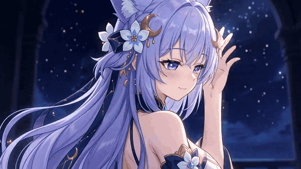
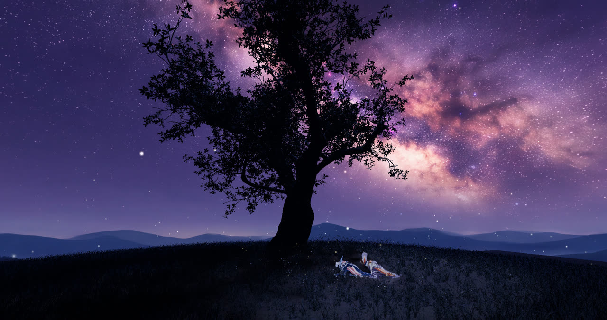
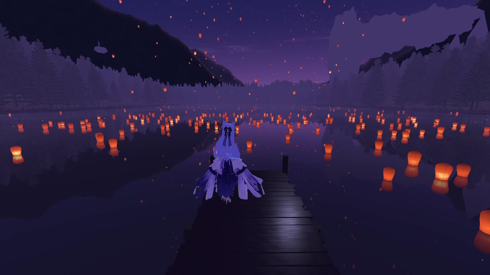
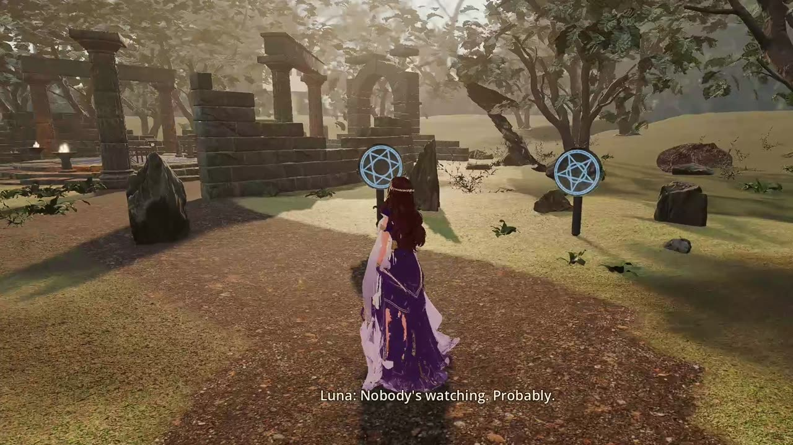
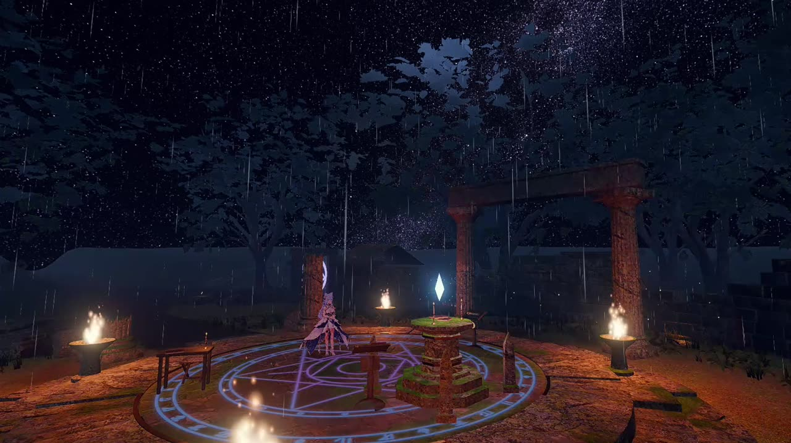
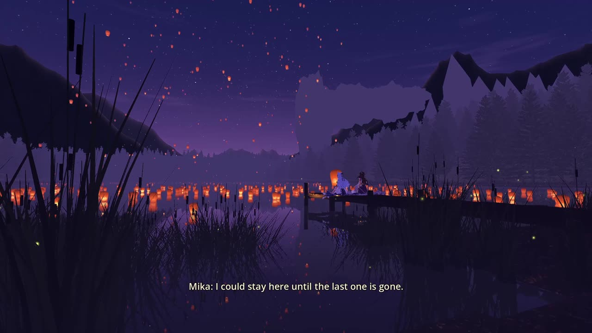
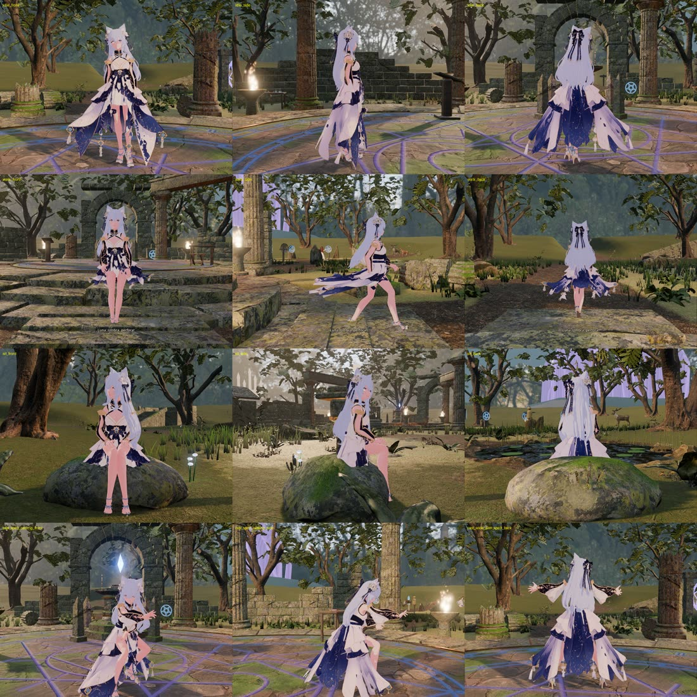
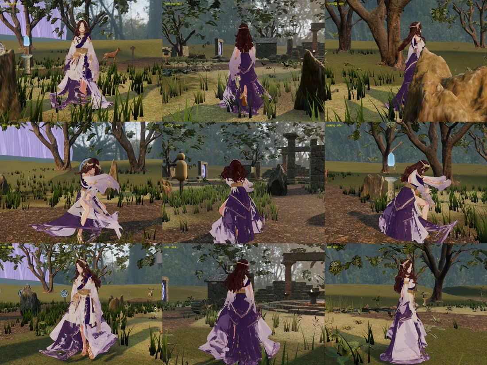
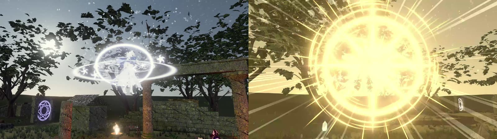

<p align="center">
  <a href="https://www.youtube.com/@SelwynBuilds-j1s/live"></a>
</p>

<h1 align="center">Mika World</h1>

<p align="center">
  <b>Mika and Luna, autonomous AI mages living in a Godot 3D world, live on YouTube.</b><br>
  <a href="https://www.youtube.com/@SelwynBuilds-j1s">YouTube channel</a> ·
  <a href="https://www.youtube.com/@SelwynBuilds-j1s/live">Watch the live stream</a>
</p>

Two young mages, **Mika** and **Luna**, live their own lives in a 3D fantasy world built in Godot. Nobody steers them:
each has her own mind, needs and memory, chooses what to do next from what is really there, reads the old books,
practises her spells, follows a mystery, fights what comes out of the woods, rests under the stars and talks with the
other. The whole thing is streamed live on YouTube, where viewers can chat with them and watch them grow from Level 1
toward Archmage.

## Gallery

| | |
|:---:|:---:|
| <br>**Starfall Hill**: their night spot under the Milky Way | <br>**Lantern Lake** *(Day 2)*: paper lanterns over the water |
| <br>**Arcane Sanctuary**: ruins in a forest clearing | <br>**Ritual Circle** at night |

<p align="center"><br>
<i>Mika and Luna sitting at the end of the pier, letting a lantern go</i></p>

## Mika and Luna

| Mika | Luna |
|:---:|:---:|
|  |  |
| A cheerful apprentice: bright, gentle, playful and warm. Wind and starlight magic, her first spell a Gale Spiral, and the one who reads every old book in the sanctuary. *"Hi. I'm Mika. I study here, in the old circle."* | A quiet, clever moon mage: calm, curious, a little mysterious and sometimes teasing. Moonlight and shadow, an Umbral Lance, and a taste for a good fight. *"Luna. I came for the circle's power, not for company."* |

## Features

- **An autonomous brain for each mage.** A planner that generates real options from the world (books she has
  noticed, spells and fitting targets, places, the other mage, visitors, creatures) and scores them by her needs
  (energy, curiosity, mastery, company), temperament, story pull, novelty and saved per-activity cooldowns. An optional
  LLM curiosity hint can only nudge a valid option; it never invents actions.
- **Day and night on the game clock** *(Day 2 update)*. Dusk and dawn blend the sky, sun, fog and grade; lanterns,
  fireflies and the Milky Way come out at night. Nights are for Starfall Hill or Lantern Lake, stargazing on open
  grass, and the creatures that only come out after dark.
- **A story that only moves on what they actually learn.** *Echoes of the Heartstone*: clues come from pages really
  read, spells really cast and conversations really had, in any order, across the home region (the sanctuary, its
  library, the Whispering Woods, the Mentor's Tower and, with the Day 2 update, Lantern Lake).
- **Real-time transformations** *(in development, `transformation-outfits`)*. At each tenth level a mage transforms at night, in the world: wind and petals, a rise
  into the air, a body of light, the outfit changing inside it, a burst and a slow descent in her new form.
  <br>
- **Spells as reusable templates** *(in development)*. Each spell shape (projectile, beam, burst, shield, aura, slash) is built once and
  recoloured by element from a data file (`data/elements.json`); mastering a new element changes every spell's look
  with no new effect work. Duels and fights use the same system, pooled and pre-warmed to hold 30 fps on stream.
- **Persistent lives.** Levels, skills, knowledge, journal, relationships and where each one was are saved; a restart
  resumes where they left off.
- **Camera director** for the stream: wide and medium shots only (a permanent no-close-up rule), staged scenes for
  conversations, fights, transformations and quiet moments.

## How it connects to Mika-Live (VR-Agent)

The world is the **Stage**; [Mika-Live](https://github.com/RandomSci/VR-Agent) (a fork of Open-LLM-VTuber) is the
show around it: chat, speech, the stream itself.

```
YouTube chat ──> Mika-Live (VR-Agent) ──WebSocket "live link"──> Godot world (this repo)
                  chat replies, show lines,                        the mages' own lives, camera,
                  TTS voices, stream control                       world state, voiced lines
                       │                                                  │
                       └── OBS ── YouTube <── /dev/video42 <── stage_bridge.py <── headless gamescope
```

- Mika-Live starts the world with `tools/godot-stage.sh` (in VR-Agent):
  `--profile=stream --viewer --brain --live-link --no-bridge`, inside a headless gamescope on the GPU.
- Frames go through `stage_bridge.py` into a v4l2loopback device (`/dev/video42`) that OBS reads as the
  "Godot World" source; the world's audio plays into its own PulseAudio sink (`MikaWorld`).
- Over the live link (`scripts/live/live_link.gd`) the world reports what is true right now (place, activity,
  levels, spells, weather, a fresh topic to talk about); the server sends show lines to speak, viewer messages and
  requested activities, which the mages carry out through their own planners (always something real and possible).

## Running it

1. **Godot 4.7.2 stable** (Forward+, Vulkan). Fresh clone: run `tools/setup_local_assets.sh` (re-copies the
   git-ignored Mixamo clips), then open the editor once or run `godot --headless --path . --import` (the import
   cache, about 5 GB, is built in `.godot/`).
2. Launch:
   ```bash
   ./run.sh                 # STREAM profile: adaptive quality holding a stable 30 fps
   ./run.sh live --brain    # the mages decide for themselves; the camera director frames them
   ```
   Exact command: `godot --path . -- --profile=stream --brain` (the live stage adds `--viewer --live-link`).
3. Optional `.env` (never committed): `OPENAI_API_KEY` for the DEV LLM, `GEMINI_API_KEY` for Gemini voices. Without
   them the world runs with mock dialogue and offline voices.
4. Tests: `godot --path . -- --mktest=<mode> --fresh --save-path=user://test_regress_<mode>.json` (see
   `scripts/tests/`); tests refuse to run on a real save.

Controls, flags, milestones and the bridge API: **[docs/DEVELOPER_GUIDE.md](docs/DEVELOPER_GUIDE.md)**.

## Not in the repo

| What | Where it lives locally | Why |
|---|---|---|
| `.godot/` import cache, logs, `screenshots/` test captures, recordings | the working copy / `~/.cache` | generated |
| `.env`, `.env.dev`, `override.cfg` | the working copy | secrets / per-machine |
| Mixamo animation FBX (`assets/animations/mixamo/`, `mixamo_sword/`, ~56 MB) | the owner's Mixamo downloads | not redistributable as raw files |
| Song audio (`assets/audio/music/library/*/*.mp3`) | the working copy | broadcast rights not confirmed |

One file is larger than 50 MB and is kept as a normal Git object (under GitHub's 100 MB limit):
`assets/polyhaven/models/island_tree_01/island_tree_01.bin` (57.9 MB, Starfall Hill's tree, Poly Haven CC0).

## Credits

Assets and licences: [CREDITS.md](CREDITS.md), [docs/ASSET_SOURCES.md](docs/ASSET_SOURCES.md). Environment art mostly
from Poly Haven (CC0); animations from Quaternius' Universal Animation Library (CC0) and the owner's Mixamo set.
