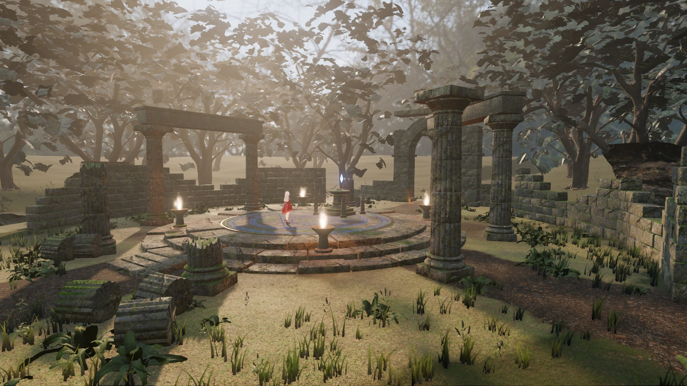

# Mika World 2.0: Arcane Sanctuary (Godot 4.7.2, DEV)

An independent Godot project. The **real Mika** (her VRoid VRM with MToon shading and spring bones) walks through a ruined forest sanctuary built from CC0 photogrammetry assets and casts a layered, animation-synced arcane spell.
It does **not** touch the production Three.js stream, OBS, YouTube, production ports, credentials or memory.



## Launch

```bash
cd ~/Downloads/Mika-Godot-Dev
./run.sh            # CINEMATIC (Forward+/Vulkan)
./run.sh live       # LIVE_OPTIMIZED: use this while OBS + the live stream share the laptop
./run.sh night      # CINEMATIC at night
./run.sh compat     # OpenGL Compatibility fallback
./run.sh tour       # automated screenshots + perf report -> screenshots/, then quits
./run.sh editor     # open in the Godot editor
```

Exact command behind `./run.sh`:
`~/Downloads/Godot-Engine/Godot_v4.7.2-stable_linux.x86_64 --path ~/Downloads/Mika-Godot-Dev -- --profile=cinematic`

After a fresh clone, run `tools/setup_local_assets.sh` once (re-copies the git-ignored Mixamo FBX files), then open the editor or run `--headless --import`.

### Controls

| Input | Action |
|---|---|
| W A S D | move (camera-relative) |
| Shift | run |
| Mouse | orbit camera (click to capture; Esc releases; or hold right button) |
| Wheel | zoom |
| Space | cast **Arcane Orb** |
| N | toggle day / night |
| P | cycle CINEMATIC → LIVE_OPTIMIZED → ULTRA |
| H | toggle HUD |
| F12 | screenshot to `screenshots/` |

## What's in the build

* **Real Mika avatar**: `Mika.vrm` (VRM 1.0, the canonical "FORMAL"/World-Edition outfit used by production) imported natively by V-Sekai **godot-vrm** (pinned to the commit that adds Godot 4.7 support). It keeps MToon materials, transparency, all 18 expressions, 49 spring-bone chains (hair, ears, tail), and the humanoid `GeneralSkeleton`. Blinking plus relaxed/happy/surprised expressions are driven during casts.
* **Animation**: 11 Mixamo clips retargeted by Godot's own importer (`BoneMap` → `SkeletonProfileHumanoid`, overwrite-axis rest fixer, matching the VRM importer's convention). Unmapped bone tracks are dropped and locomotion is made in-place at runtime. The `AnimationTree` has an idle/walk/run blend space with stride-matched time-scale, plus a cast one-shot.
* **Character controller**: `WorldCharacter` (`CharacterBody3D`, capsule, gravity, floor snap, Jolt physics) is input-agnostic: player, AI bridge, or a future companion drive the same API. Measured: walk 1.46 m/s, run 4.24 m/s, feet on the ground (y error < 1 cm).
* **Sanctuary**:
  * Custom Blender-modelled architecture (`tools/blender/build_sanctuary_architecture.py`, every block a real bevelled piece): a 3-tier segmented dais, 8 fluted columns with entasis (3 broken, plus fallen drums), lintels, a 13-voussoir arch gateway, curved masonry ruin walls, an octagonal spell altar with gold bands, and braziers.
  * Textured with Poly Haven `mossy_rock` / `monastery_stone_floor` + ambientCG moss through a triplanar weathering shader.
  * Poly Haven scanned rocks (two moss sets, `boulder_01`, `rock_face_01/02`, `namaqualand_boulder_02`), ferns, shrubs, stumps, roots, books, candleholders, lanterns, `gothic_statue`.
  * LOD-reduced `jacaranda_tree` forest; procedural geometry grass; a 3-layer PBR terrain (`leafy_grass`, `forrest_ground_01`, `stony_dirt_path`).
  * Engraved procedural rune circle in the floor that charges during casts.
  * Training clearing with a standing-stone ring (east), reserved for the mentor.
* **Lighting**: CC0 HDRI skies (`nature_reserve_forest` by day, starry `kloppenheim_02` by night); a warm low sun with 2-cascade soft shadows; AgX tonemapping; HDR-threshold glow (only magic and flames bloom); SSAO, SSIL, SSR, and light volumetric fog (CINEMATIC); flickering braziers and candles.
* **Arcane Orb** (`scripts/magic/arcane_orb_spell.gd`), with phases keyed to the clip's own timeline:
  1. A sigil draws itself under her feet and the dais runes wake outward.
  2. Motes stream into her hands and hand lights build.
  3. Three geometric sigil rings draw themselves around a forming orb (hot core + writhing shell + haze) with orbiting comet trails.
  4. The orb's light (shadowed in CINEMATIC) and a stone "magic bounce" term light the surroundings.
  5. Release: the orb launches, then bursts in sparks and a shockwave.
  6. Clean fade; she returns to idle.

## Render profiles (measured on this laptop, 1600×900, with OBS streaming)

All numbers are real measurements from `./run.sh tour` (`docs/report_cinematic.json`) and quick tours. Intel Raptor Lake-P iGPU, Vulkan 1.4.305 (Mesa). The NVIDIA RTX 5050 driver is not loaded, so the iGPU does everything.

| Profile | Renderer | Settings | FPS | GPU ms/frame | Draw calls | Video mem |
|---|---|---|---|---|---|---|
| CINEMATIC | Forward+ Vulkan | full res, TAA, SSAO(med) + SSIL + SSR, vol. fog, 4096 shadows | **14–18** (varies with OBS load) | 55–74 | 80–220 | ~750 MB |
| LIVE_OPTIMIZED | Forward+ Vulkan | 75% FSR1, FXAA, SSAO(low), no SSIL/SSR/vol. fog, 2048 shadows, 55% foliage, 30 FPS cap | **30 (capped)** | 28–30 | 120–220 | ~600 MB |
| Compatibility | OpenGL 4.6 | LIVE settings; no SSAO/SSIL/SSR/vol. fog | **30 (capped)** | ~14.5 | 130–250 | — |
| ULTRA | Forward+ | SDFGI, 4 cascades, 8192 shadows, MSAA 2× | *defined, not run here* (meant for stronger GPUs) | | | |

Peak process RSS: ~1.17 GB (CINEMATIC), ~0.77 GB (LIVE_OPTIMIZED); Godot static memory ~270–280 MB. Primitives per frame: ~1.5–2.8M after optimization (down from 38–63M in the first build).

## AI bridge (isolated, DEV only)

`scripts/bridge/action_bridge.gd` is newline-delimited JSON over TCP on **127.0.0.1:47651**. It's localhost only, never a production port, and if the port is busy the bridge disables itself instead of picking another. Disable with `--no-bridge`. The renderer only executes actions and reports real outcomes; no brain lives here.

Commands: `observe`, `navigate_to {target: poi_id | [x,y,z], run}`, `look_at {target}`, `cast_spell {spell: "arcane_orb", clip}`, `start_training`, `stop`, `list_interactions`.
Events: `action_started`, `action_finished {ok, detail, observation}`, `cast_phase {awaken|gather|release|burst|resolved}`.
Observations: position, facing, speed, current area, nearby POIs (distance + bearing), visible POIs (view cone + line-of-sight raycast), available interactions, other characters, recent events.

```bash
./run.sh live &                    # game with bridge
python3 tools/bridge_client.py     # observe → walk to altar → look at arch → cast → refusal tests → training
```

There's also an offline mock: `godot --path . --headless -- --mock-commands=res://tests/mock_commands.json`.

To connect Mika's existing Python intelligence later, wrap `tools/bridge_client.py`'s `Bridge` class in an adapter that maps planner intents to these commands. The planner, personality and memory stay untouched.

## Layout

```
scenes/main.tscn            entry scene → scripts/main.gd (composition root, character registry)
scripts/core/               RenderProfile (profiles + CLI options), GameInput (input map)
scripts/world/              sanctuary.gd (world), terrain.gd, materials.gd
scripts/characters/         world_character.gd (any VRM humanoid), player_controller.gd
scripts/camera/             third_person_camera.gd
scripts/magic/              arcane_orb_spell.gd
scripts/bridge/             action_bridge.gd
scripts/tour_runner.gd      automated screenshots, movement/bridge/cast tests, perf probe
shaders/                    stone_triplanar, rune_floor, terrain_blend, grass_blades, magic/*
tools/                      asset fetch/LOD/import tools, Blender generators, bridge client
assets/                     Mika.vrm, Mixamo imports, CC0 assets (see ASSETS.md)
legacy/                     the original procedural prototype (kept for reference)
docs/screenshots/           real runtime captures from this machine
```

## Known issues

* **CINEMATIC runs at ~17 FPS** on the iGPU while OBS shares it. It's fine for screenshots and recording, but LIVE_OPTIMIZED is the profile to use alongside the live stream. LIVE has little headroom (GPU ~28–30 ms against a 33 ms budget).
* The NVIDIA RTX 5050's driver isn't loaded on this Debian install. With it, CINEMATIC/ULTRA should be far faster; this wasn't changed (no driver changes per instructions).
* Trees come from a single species (2 LODs, random scale/rotation). The canopy looks good at mid distance, but up close the enlarged leaf clusters reveal the thinning.
* Distant terrain beyond the tree ring is open woodland floor, not dense forest.
* Spring bones (hair/tail) run through godot-vrm's `SkeletonModifier3D`. They behave plausibly in captures but weren't tuned.
* The orb's release direction is fixed (forward + up). There's no target selection or impact interaction yet.
* `navigate_to spell_altar` arrives ~0.8 m from the POI marker because the pedestal's collider is in the way (reported honestly in the result).
* The VRM's own license field says `commercialUsage: personalNonProfit`. That's the creator's setting; worth reviewing before monetized use.

## Next steps

1. Tree variety: a second species (Poly Haven `island_tree_02` / `fir_tree_01` through the same LOD tools), plus impostors for the far ring.
2. Expand LIVE headroom: occlusion culling (architecture as occluders), lower grass density at distance, baked shadows for static geometry.
3. A mentor character: `spawn_character("mentor", …, world.spawn_point("companion"))` already works with any VRM. Give it its own controller and a second spell.
4. Bridge adapter for the existing Mika planner; add `study_spellbook` interaction and target-directed spells.
5. Terrain3D (verify a 4.7-compatible release first) for painted, larger landscapes.
