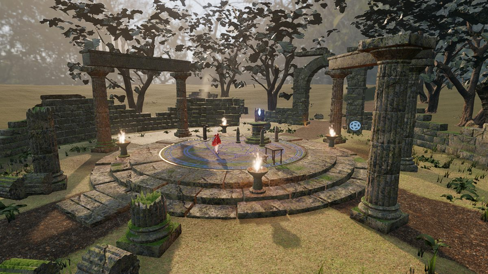
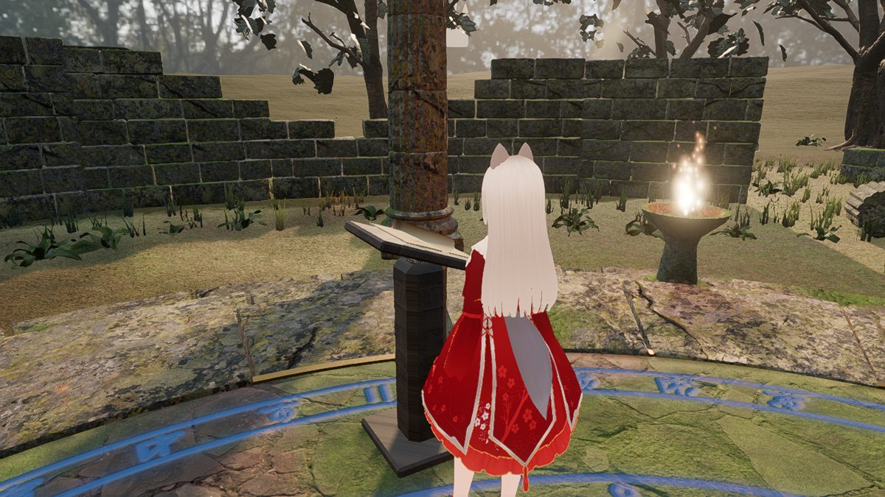
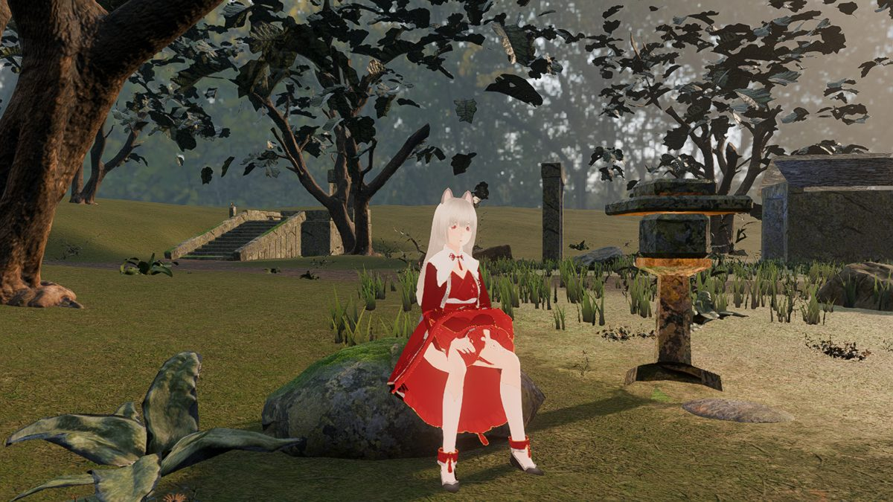
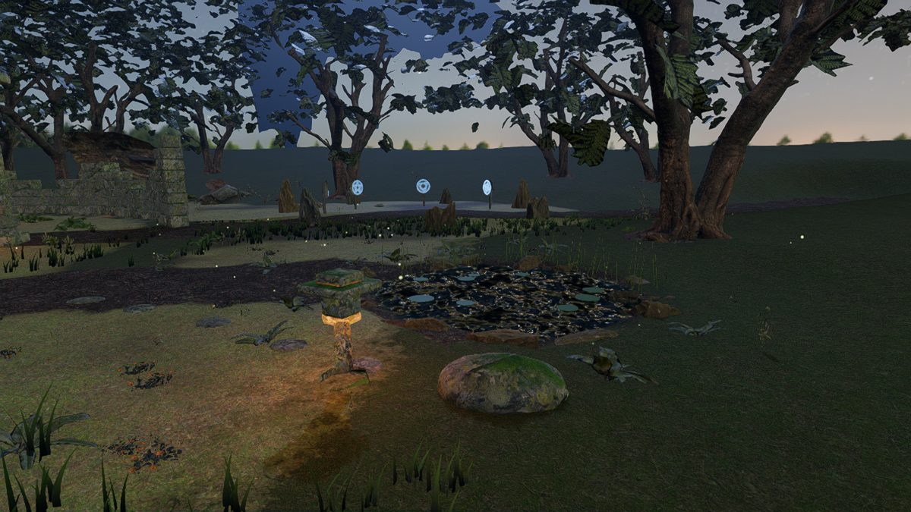
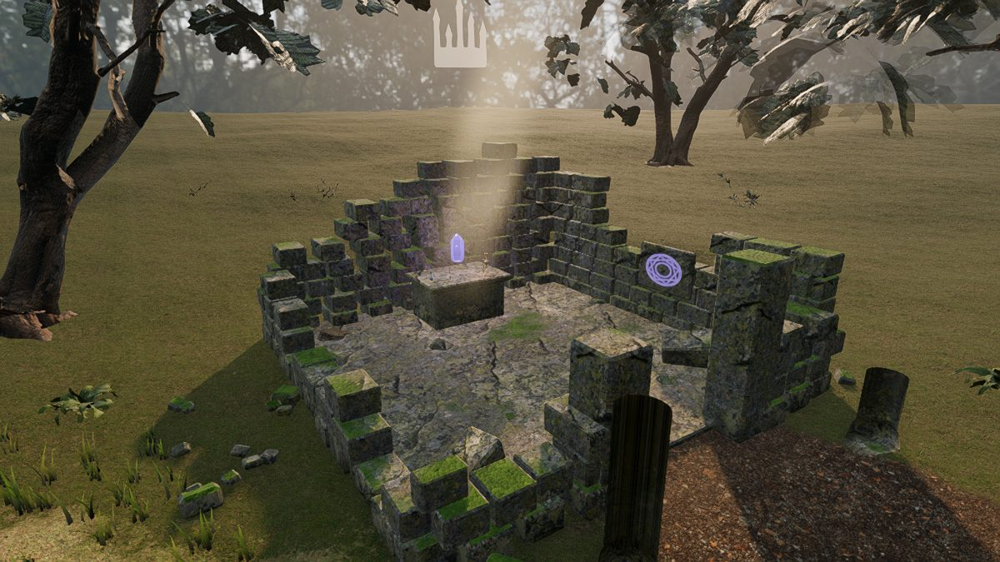
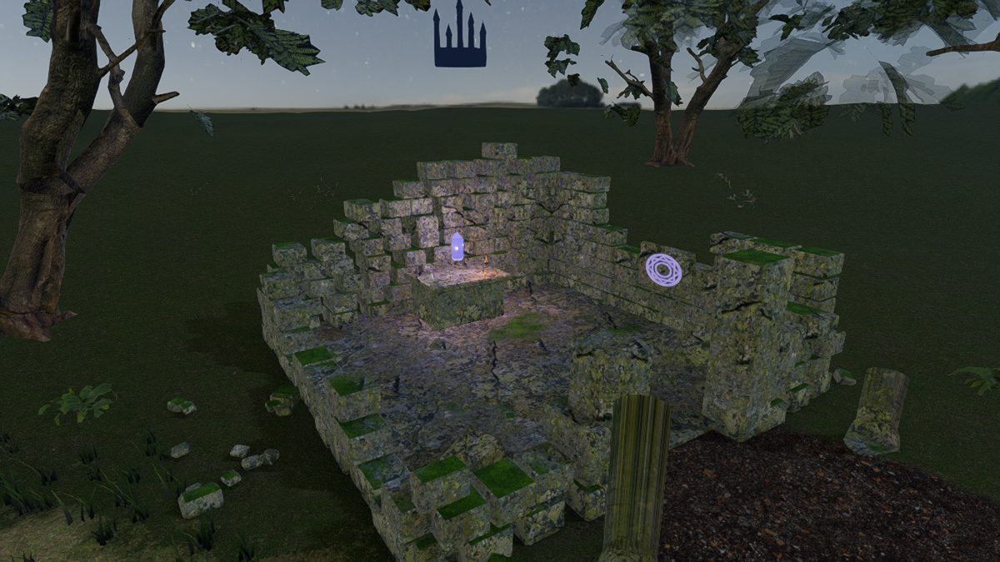
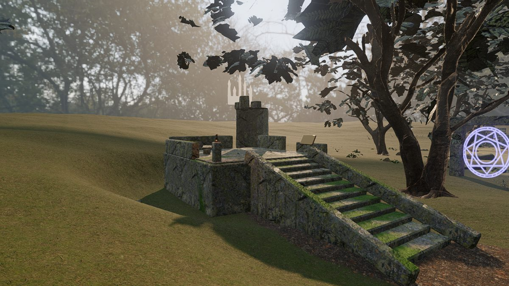
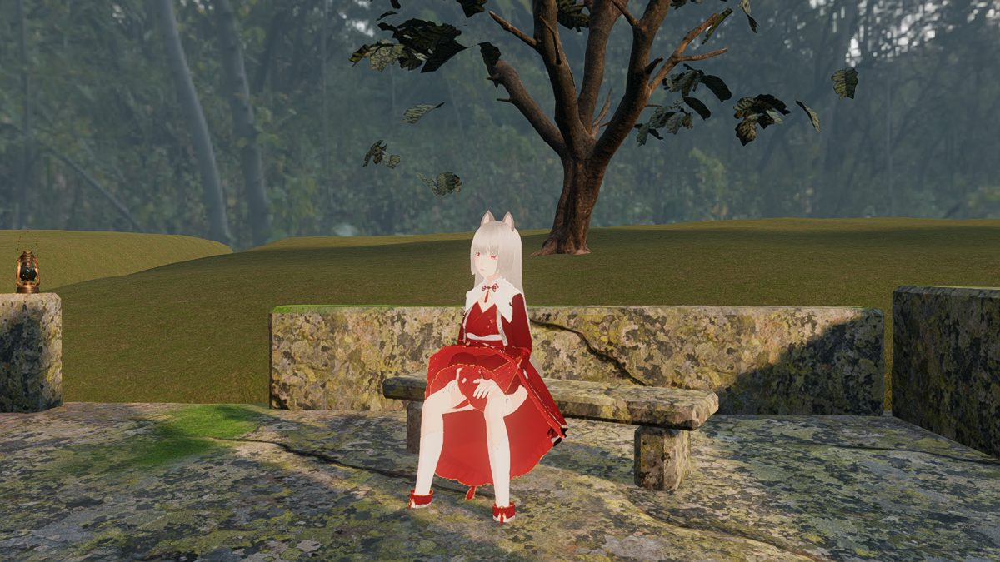
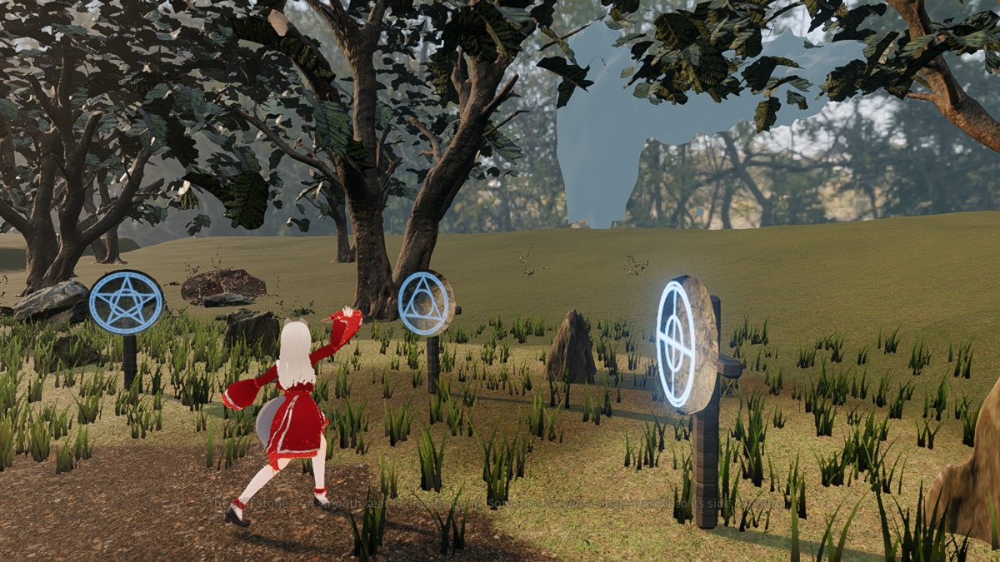
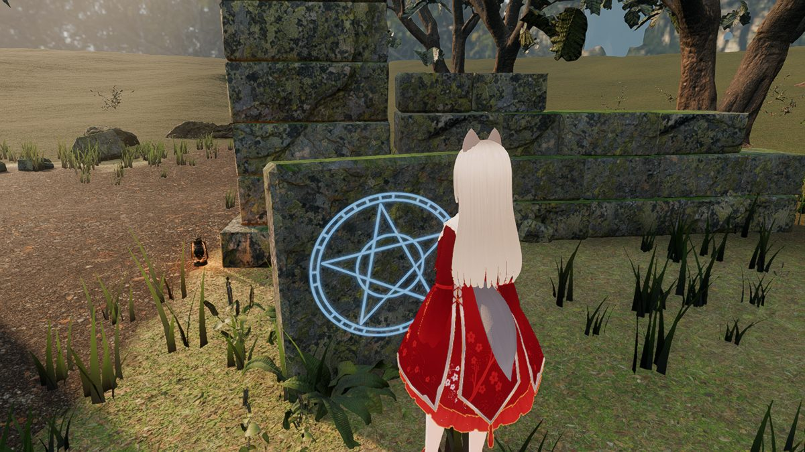

# Arcane Sanctuary — Mika's home base (mini-region)

Measured on this laptop (Intel Raptor Lake-P iGPU, Vulkan/Forward+, 1600×900, 30 FPS cap in LIVE_OPTIMIZED). Regenerate: run `--sanctuarytour=full` (LIVE) / `--sanctuarytour=activities` (CINEMATIC), then `python3 tools/make_sanctuary_report.py`.

## Story

Long ago the mages of the First Circle raised this sanctuary where three ley-lines cross. The circle fell silent for centuries until Mika found it, woke the runes with her first spell, and made the ruins her home. Here she trains to become a true mage — from Novice toward the higher circles — while slowly uncovering why the First Circle disappeared.

**Mission:** Path of the Mage: complete the Apprentice Trials of the Sanctuary and rise in rank.

Ranks: Novice (0 trials) → Apprentice (3 trials) → Initiate of the First Circle (6 trials) → Sanctuary Adept (8 trials, skill ≥ 2.0).

## Sub-areas

| sub-area | purpose | activities |
|---|---|---|
| **Ritual Circle** | Casting and attunement on the engraved dais; heart of the sanctuary. | `study_first_scroll` (study), `study_altar_book` (study), `attune_circle` (practice), `cast_in_circle` (practice), `write_journal` (rest) |
| **Ancient Spell Library** | Stairway down to the vaulted library: study spells, scrolls and history. | `study_library` (study) |
| **Meditation Garden** | Quiet pond, stone seat and lantern: rest, meditate and restore focus. | `meditate_garden` (meditate), `watch_pond` (rest) |
| **Training Grounds** | Standing stones and rune targets: practise strikes and spells. | `practice_targets` (practice), `practice_stones` (practice) |
| **Ruined Forest Gate** | The voussoir archway where the forest path leaves the sanctuary; fallen stones and an old inscription. | `read_gate` (inspect), `inspect_statue` (inspect) |
| **Shrine / Altar Chamber** | A roofless chamber holding the Heartstone relic, offering bowls and a lore tablet. | `read_tablet` (study), `attune_heartstone` (practice) |
| **Scenic Watchpoint** | A raised ruin on the southern rise overlooking the whole sanctuary and the far landmarks. | `survey_watchpoint` (explore), `rest_watchpoint` (rest) |

Trials: Read the Scroll of the First Circle; Attune to the Ritual Circle; Strike all four rune targets; Meditate on the Still Stone; Study the Warding Glyph in the library; Read the inscription on the forest gate; Attune the Heartstone relic; Survey the realm from the Watchpoint.

## LIVE_OPTIMIZED

| sub-area | establishing FPS / GPU ms | worst frame ms | activity FPS / GPU ms | camera during activity | activity result | night FPS / GPU ms |
|---|---|---|---|---|---|---|
| altar_chamber | 30.1 / 23.01 | 36.37 | 31.8 / 25.17 | activity | ✓ practice: Attune to the Heartstone relic | 30.2 / 22.76 |
| ancient_spell_library | 30.2 / 23.25 | 39.19 | — / — | — | — | — / — |
| meditation_garden | 30.1 / 25.01 | 36.21 | 31.8 / 26.13 | activity | ✓ meditate: Meditate on the Still Stone | 30.2 / 24.05 |
| ritual_circle | 30.1 / 27.47 | 36.62 | 31.6 / 29.12 | activity | ✓ study: Read the Scroll of the First Circle | 30.2 / 27.13 |
| ruined_forest_gate | 30.0 / 22.5 | 38.59 | 31.8 / 24.11 | activity | ✓ inspect: Read the inscription on the forest gate | — / — |
| training_grounds | 30.1 / 23.03 | 36.54 | 31.8 / 22.05 | activity | ✓ practice: Strike rune target 2 | 30.1 / 22.49 |
| watchpoint | 30.2 / 20.52 | 37.11 | 31.9 / 14.87 | activity | ✓ rest: Sit and rest on the watchpoint bench | 30.1 / 20.62 |

Sanctuary activation (first load, behind the travel mask): total 3606 ms, build 2054 ms in 16 frames, worst step 520.79 ms (architecture trimesh collision, pre-existing), nav bake 194 ms, static memory 245.6 MB, video 780.5 MB, 830 nodes, layout hash `ea24441ee943`.

GPU cost by category at the classic establishing view (all: 26.13 ms, 1705600 primitives):

| hidden category | saves GPU ms | saves primitives |
|---|---|---|
| trees | 4.87 | 582212 |
| terrain | 3.4 | 240000 |
| architecture | 2.48 | 320612 |
| foliage | 2.42 | 49052 |
| rocks | 0.19 | 113900 |
| expansion | 0.09 | 29362 |
| props | -0.04 | 13866 |
| ambient | -0.25 | 60 |
| vista | -0.32 | 1732 |

## Cost of the expansion (A/B, LIVE_OPTIMIZED, same cameras)

| view | without expansion GPU ms | with expansion GPU ms | Δ |
|---|---|---|---|
| altar_chamber | 20.91 | 22.41 | +1.5 |
| ancient_spell_library | 22.67 | 23.11 | +0.44 |
| meditation_garden | 22.06 | 24.34 | +2.28 |
| ritual_circle | 26.26 | 26.93 | +0.67 |
| ruined_forest_gate | 22.51 | 22.35 | -0.16 |
| training_grounds | 22.1 | 22.51 | +0.41 |
| watchpoint | 19.99 | 20.04 | +0.05 |
| probe_view | 25.15 | 26.06 | +0.91 |
| altar_chamber_night | 20.56 | 22.28 | +1.72 |
| meditation_garden_night | 21.78 | 23.51 | +1.73 |
| ritual_circle_night | 26.12 | 26.77 | +0.65 |
| training_grounds_night | 21.88 | 21.77 | -0.11 |
| watchpoint_night | 19.62 | 19.92 | +0.3 |

## CINEMATIC

| sub-area | establishing FPS / GPU ms | worst frame ms | activity FPS / GPU ms | camera during activity | activity result | night FPS / GPU ms |
|---|---|---|---|---|---|---|
| altar_chamber | 20.7 / 48.43 | 56.92 | 20.2 / 50.95 | activity | ✓ practice: Attune to the Heartstone relic | 20.4 / 48.75 |
| ancient_spell_library | 17.1 / 58.27 | 68.01 | — / — | — | — | — / — |
| meditation_garden | 17.4 / 57.08 | 63.77 | 18.3 / 56.83 | activity | ✓ meditate: Meditate on the Still Stone | 17.9 / 55.61 |
| ritual_circle | 15.9 / 62.9 | 68.29 | 16.8 / 62.0 | activity | ✓ study: Read the Scroll of the First Circle | 15.9 / 62.04 |
| ruined_forest_gate | 18.7 / 52.95 | 58.04 | 18.2 / 57.12 | activity | ✓ inspect: Read the inscription on the forest gate | — / — |
| training_grounds | 18.0 / 55.26 | 62.36 | 19.0 / 54.76 | activity | ✓ practice: Strike rune target 2 | 18.4 / 53.99 |
| watchpoint | 25.0 / 39.74 | 44.27 | 28.3 / 35.97 | activity | ✓ rest: Sit and rest on the watchpoint bench | 24.7 / 40.07 |

Sanctuary activation (first load, behind the travel mask): total 7233 ms, build 4141 ms in 14 frames, worst step 533.83 ms (architecture trimesh collision, pre-existing), nav bake 242 ms, static memory 265.2 MB, video 898.3 MB, 916 nodes, layout hash `b54f1da8d91c`.

GPU cost by category at the classic establishing view (all: 59.97 ms, 2549421 primitives):

| hidden category | saves GPU ms | saves primitives |
|---|---|---|
| trees | 11.93 | 1060833 |
| terrain | 6.82 | 240000 |
| foliage | 6.04 | 59318 |
| architecture | 1.15 | 321788 |
| rocks | 0.97 | 227828 |
| expansion | 0.62 | 29370 |
| ambient | 0.16 | 78 |
| vista | 0.1 | 1732 |
| props | -0.24 | 27738 |

## Mika's own decisions (SanctuaryBrain, 150 s, no external AI)

| t (s) | action | utility | ok | result |
|---|---|---|---|---|
| 0.0 | `survey_watchpoint` | 1.056 | ✓ | explore: Survey the realm from the Watchpoint |
| 29.1 | `study_library` | 0.764 | ✓ | study: Study the Warding Glyph on the spell lectern |
| 49.9 | `attune_circle` | 0.65 | ✓ | meditate: Attune to the ritual circle |
| 61.7 | `practice_targets` | 0.607 | ✓ | practice: Strike rune target 1 |
| 80.8 | `meditate_garden` | 0.815 | ✓ | meditate: Meditate on the Still Stone |
| 94.2 | `study_first_scroll` | 0.392 | ✓ | study: Read the Scroll of the First Circle |
| 102.1 | `study_altar_book` | 0.379 | ✓ | study: Study the spellbook on the altar |
| 110.0 | `attune_circle` | 0.405 | ✓ | meditate: Attune to the ritual circle |
| 125.2 | `practice_targets` | 0.583 | ✓ | practice: Strike rune target 2 |
| 140.7 | `meditate_garden` | 0.891 | ✓ | meditate: Meditate on the Still Stone |

Performance while the brain + director run: 30.9 FPS, GPU 27.53 ms, worst frame 37.08 ms.

After the whole tour: rank **Initiate of the First Circle**, trials 7/8.

## Screenshots (LIVE_OPTIMIZED)

| | |
|---|---|
|  Ritual Circle (establishing) |  Reading the Scroll of the First Circle (director: over-the-shoulder) |
|  Meditating on the Still Stone |  Garden at night (fireflies, stone lantern) |
|  Shrine / Altar Chamber |  Chamber at night (Heartstone) |
|  Scenic Watchpoint |  Resting on the Watchpoint bench |
|  Rune target lighting up (side-on practice framing) |  Ruined Forest Gate inscription |

## Remaining issues (honest list)

* CINEMATIC stays below 30 FPS in the Sanctuary on this iGPU (16–25 FPS); LIVE_OPTIMIZED is the streaming profile.
* Single tree species; the far tree LOD reads as fragmented leaf cards at distance (no baked impostor treeline yet — trees are the largest GPU cost).
* The pond outline follows the 1 m terrain grid (slightly polygonal); rim stones/reeds hide most of it.
* "Wide Arm Spell Casting" rotates her hips, so the Heartstone attunement uses "Spell Casting" instead.
* Sitting uses the Mixamo "Sitting Idle" one-shot (≈6 s) — there is no sit-down/stand-up transition clip, so she blends into and out of the seat.
* No deer/fox: no suitable CC0 rigged animal is available locally, so none was faked. No mentor NPC (no second licensed VRM); the director's conversation two-shot is implemented and reachable via `camera{mode:"conversation", with:<character>}` but untested with a real NPC.
* Thoughts are templated lines from `data/sanctuary.json` (by design: no LLM calls); an external AI can read `region_context` and drive her instead.
* The architecture step (Blender trimesh collision, pre-existing) is a 0.5 s build step, hidden behind the travel mask.
